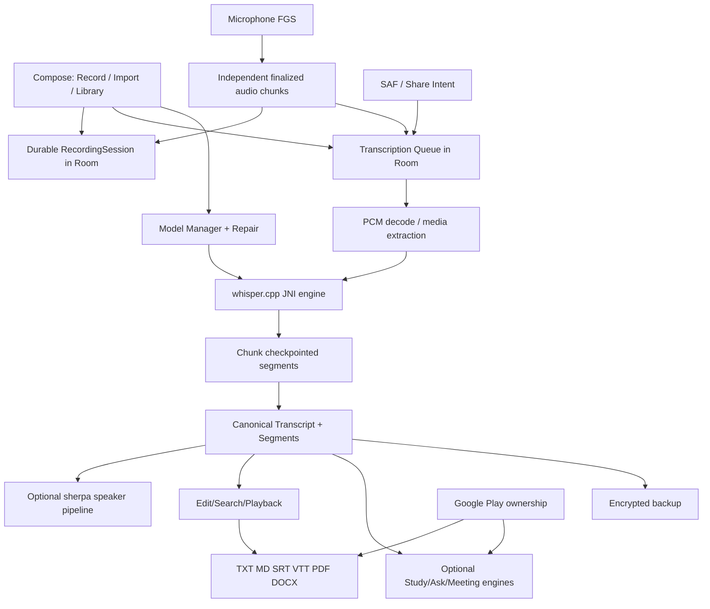

# OfflineTranscriber vs LoroNote — Competitive Intelligence, Source Audit, Review Analysis & Product Roadmap

**Research cut-off:** 24 October 2026  
**Your Android repository:** [prem704raj/OfflineTranscriber](https://github.com/prem704raj/OfflineTranscriber)  
**Repository snapshot audited:** [`79dccc7692c19d7e4c942dcff7e889653bbe4da5`](https://github.com/prem704raj/OfflineTranscriber/tree/79dccc7692c19d7e4c942dcff7e889653bbe4da5) (`main` when read)  
**Main competitor:** [LoroNote — Speech to Text (iOS)](https://apps.apple.com/us/app/loronote-speech-to-text/id6749249346)  
**Intended audience:** Indian students and professionals; low/mid-range Android phones; limited data connectivity; English, Hindi, Hinglish, and Indian regional languages.  
**Research types:** Direct review of selected repository source files; competitor's App Store and official website; publicly accessible review text; official Android platform documentation; developer-reported business posts. **No Android build or physical-device testing was performed.**

---

## 0. Read this first — what is verified, and what isn't

This report is not a marketing comparison disguised as an engineering audit. It uses these evidence labels:

- **[SOURCE-CODE VERIFIED]** A class, manifest declaration, policy, or operation is present in the inspected GitHub commit. It does **not** mean it works correctly on every phone.
- **[LISTED]** LoroNote advertises the feature in its App Store, website or changelog. We did not reverse-engineer its private implementation or test it on an iPhone.
- **[REVIEW SIGNAL]** At least one public reviewer reported an experience. This is evidence of a user complaint/praise, **not** proof that every installation is affected.
- **[NOT FOUND]** Not found in the inspected repository's app-side source file paths or targeted files. This is weaker than an exhaustive absence proof; check runtime screens and any unpublished branches.
- **[HYPOTHESIS]** An idea to validate using benchmarks, beta feedback or usage data.
- **[RISK / INVESTIGATE]** Code inspection reveals a potential failure mode; reproduce it before declaring it a confirmed production bug.

**Review-count limitation:** LoroNote's developer website described about **279 worldwide ratings** in an August 2026 article, while the US storefront had **52 ratings** when examined here. A third-party App Store index identifies **29 written reviews**, and its publicly rendered page exposes a smaller visible subset. **Ratings are not written reviews.** There is no verified corpus of 100+ distinct written LoroNote reviews available from these sources. This report therefore analyzes the verifiable qualitative comments without inventing hundreds of reviews, review quotations, frequencies, or statistical confidence. See §3 for the precise methodology and source links.

**Executive finding:** You already have far more implemented architecture than the previous hypothetical roadmap suggested. *Do not rebuild speech recognition, subtitle export, PDF/DOCX, speaker diarization, search or study tooling from scratch.* Your stronger opportunity is **loss-resistant recording, stable models and imports, measured Hindi/Hinglish quality on inexpensive Android devices, clear upgrade value, and much simpler first-use UX**.

---

## 1. Product positioning and competitor profile

### 1.1 LoroNote's actual promise

LoroNote markets itself as a fully on-device transcription and personal notes workflow. Its claimed value proposition is **accurate speech-to-text with no transcription upload**, complemented by accessible recording, imports, editing, speaker labels, summaries and sharing. The key is not that Whisper exists but that a nontechnical customer can finish a task: capture → transcribe → correct → find → use/export.

| Attribute | Observed / reported | Source & caveat |
|---|---|---|
| Platform | iPhone, iPad, Apple Watch; no Android app advertised | [Official LoroNote](https://loronote.com/) |
| Developer | Rich Soft Co., Ltd. | [Apple listing](https://apps.apple.com/us/app/loronote-speech-to-text/id6749249346) |
| Main model | Whisper Large V3 Turbo | [Apple listing](https://apps.apple.com/us/app/loronote-speech-to-text/id6749249346); implementation details are developer-described |
| Inference | Local on-device transcription; optional iCloud synchronization is separate | [LoroNote FAQ](https://loronote.com/) |
| Languages | Advertises 100+ transcription languages; storefront UI localized to 44 languages | Model capability is **not** equal to verified per-language accuracy |
| Size | About 729.8 MB on current storefront read | Size varies across versions/devices/storefront caches |
| US store rating | ~4.6/5 from 52 ratings when checked | [US App Store reviews](https://apps.apple.com/us/app/loronote-speech-to-text/id6749249346?see-all=reviews) |
| India prices displayed | ₹249 **Loro Pro Monthly** and also ₹399 **Monthly Subscription** listing; ₹1,999 yearly; ₹3,999 lifetime | [India App Store](https://apps.apple.com/in/app/loronote-speech-to-text/id6749249346). Multiple monthly products can represent historical/offer variations; confirm in actual purchase UI. |
| Official site US prices | $4.99/month, $19.99/year, $39.99 lifetime | [Official LoroNote FAQ](https://loronote.com/); storefront prices can differ |
| Free limit | First 2 minutes of each recording are free; exports constrained | [Official LoroNote FAQ](https://loronote.com/) |
| Installs | “50K+ downloads” advertised | **Self-reported** on [official website](https://loronote.com/), not audited |
| Accuracy / speed | “Up to 98%” and ~19× real-time on iPhone 15 Pro claimed | Vendor benchmarks; no model-independent validation presented |
| Device requirements | Modern Apple devices, iOS/iPadOS 18.6+ | [Apple listing](https://apps.apple.com/in/app/loronote-speech-to-text/id6749249346) |

### 1.2 Competitor features — broad inventory

**Capture and processing**: microphone recording, pause/resume, background work with caveats, model preparation, long audio support, restore/resume transcription, import audio/video from Files or external share menus, smartwatch capture, quick-record widgets, and multiple export options. **Post-processing**: automatically assigned speaker labels, editable names, manually assign speakers, synchronized transcript playback, timestamp seek, inline edits, find/replace, custom vocabulary, local AI summary/action items on compatible devices. **Organization**: folders, colored groupings, calendar view, search and multi-note export. **Retention**: drafts, keep text while deleting audio, optional automatic removal of audio, optional iCloud sync.

**Important distinctions:**
1. The Apple website describes synchronized **text/segment** highlighting. It does not establish precise **per-word** highlighting for every language.
2. “Offline” applies to inference after installation; downloading/installing the app and using optional iCloud/billing still involve network services.
3. App Store “100+ languages” is **claimed recognition coverage**, not 100+ localized app UIs or certified high accuracy.
4. Apple Intelligence summaries are **device capability dependent**, not universal.
5. An Apple Watch integration is relevant to LoroNote's ecosystem but should not become your initial Wear OS priority.

### 1.3 Revenue: useful evidence, not proof of repeatability

| Reporting date | Trailing 28-day revenue | MRR | Active subscriptions | Source |
|---|---:|---:|---:|---|
| **12 Oct 2026** | **$7,591** | **$1,295** | **258** | [Developer's Reddit post](https://www.reddit.com/r/AppBusiness/comments/1x3uagl/my_offline_transcription_app_made_76k_in_the_last/) |
| **23 Oct 2026** | **$7,085** | **$1,398** | **284** | [Later developer post](https://www.reddit.com/r/AppBuilding/comments/1xd282g/my_solo_ios_app_reached_71k_in_28day_revenue/) |

These are **developer-reported** figures from rolling 28-day windows. They include lifetime purchases and subscriptions, not just MRR. These snapshots do **not** reveal gross-to-net adjustments, refunds, ad spend, conversion, installs by market, or profitability. The 28-day figure declined between snapshots even while reported MRR and subscriber count increased; this is compatible with changing one-time purchase volume and reporting windows, but the exact mix is unknown.

The developer publicly attributes progress to App Store keyword/localization experiments, screenshots that communicate customer benefits, better recording reliability, speaker labels, and practical features. **Do not infer a causal growth uplift from any one feature**. Sources: [Oct 12 post](https://www.reddit.com/r/AppBusiness/comments/1x3uagl/my_offline_transcription_app_made_76k_in_the_last/), [earlier ASO discussion](https://www.reddit.com/r/micro_saas/comments/1wjibzu/my_solo_speechtotext_app_made_67k_in_28_days_mrr/).

### 1.4 LoroNote release history tells a strategy story

| Approx. release | Publicly described change | Competitive implication |
|---|---|---|
| Late 2025 | iPad, video import and SRT support | Import/export broadens uses beyond voice memos |
| Dec 2025 | Apple Watch and optional Apple Intelligence | Platform-specific retention and upsell |
| Jan 2026 | Custom word dictionary, search/replace, delete-audio-only | Correctibility and storage matter after transcription |
| Jan–Feb 2026 | Restore-purchase fixes, widgets and resume processing | Friction and trust are product priorities |
| Jun 2026 | More reliable recording; draft saves | Data safety is important enough to ship as a named feature |
| Jul 2026 | Speaker separation, editable labels | Power-user differentiation |
| Sep 2026 | Import from other apps, audio exports, batch export, automatic audio deletion, model-load fixes | Improve already-popular workflows rather than just adding AI tools |

Based on the [App Store version history](https://apps.apple.com/in/app/loronote-speech-to-text/id6749249346). App Store release notes are marketing statements, not proof that every bug is fixed.

---

## 2. Source-grounded audit of **your** Android app

**Snapshot:** [`79dccc7692c19d7e4c942dcff7e889653bbe4da5`](https://github.com/prem704raj/OfflineTranscriber/tree/79dccc7692c19d7e4c942dcff7e889653bbe4da5).

### 2.1 Verified stack and platform choices

- **Kotlin, Compose / Material 3, Navigation 3, Room, Media3, DataStore**, Java 17.
- **whisper.cpp JNI** with C/C++ sources plus a **sherpa-onnx Android AAR** for speaker-related functionality; native source tree is large.
- **ML Kit GenAI Prompt API** for optional on-device intelligence; dedicated classical/fallback code exists for study, Q&A, and meeting notes.
- **Google Play Billing** with a named lifetime Pro product and feature entitlements.
- **SDK**: min API 26, target/compile 36. The build currently declares `arm64-v8a`, `armeabi-v7a`, and `x86_64` ABI filters.
- **Separate FGS services**: recording, transcription, speaker diarization, caption video export and backup/restore.
- **Android share entry point**: exported `ShareReceiverActivity` handles `ACTION_SEND` and `ACTION_SEND_MULTIPLE` for audio/video.
- **APK/AAB file size, real device performance, install counts, reviews, conversion**: not established by this source inspection. Do not publish invented numbers.

Evidence: [README](https://github.com/prem704raj/OfflineTranscriber/blob/main/README.md), [app/build.gradle.kts](https://github.com/prem704raj/OfflineTranscriber/blob/main/app/build.gradle.kts), [AndroidManifest.xml](https://github.com/prem704raj/OfflineTranscriber/blob/main/app/src/main/AndroidManifest.xml).

### 2.2 Features that already exist in source — **do not build them twice**

| Area | Concrete source evidence | Interpretation / validation required |
|---|---|---|
| Native Whisper speech-to-text | [`WhisperEngine.kt`](https://github.com/prem704raj/OfflineTranscriber/blob/main/app/src/main/java/app/offlinetranscriber/mobile/transcription/WhisperEngine.kt), `whisper_jni.cpp` | Context loading, progress, segment callbacks, native cancellation hooks are present; measure accuracy, CPU, errors |
| Quantized model tiers | [`ModelCatalog.kt`](https://github.com/prem704raj/OfflineTranscriber/blob/main/app/src/main/java/app/offlinetranscriber/mobile/modelmanager/ModelCatalog.kt) | Tiny Q5 (~31 MiB), Base Q5 (~57 MiB), Small Q5 (~181 MiB) configured — **not** Large V3 Turbo |
| Device model advisor | [`DeviceModelAdvisor.kt`](https://github.com/prem704raj/OfflineTranscriber/blob/main/app/src/main/java/app/offlinetranscriber/mobile/modelmanager/DeviceModelAdvisor.kt) | RAM + CPU core heuristic exists; upgrade with real RTF/thermal data |
| Download/resume/checksum | [`ModelManager.kt`](https://github.com/prem704raj/OfflineTranscriber/blob/main/app/src/main/java/app/offlinetranscriber/mobile/modelmanager/ModelManager.kt) | HTTPS Range requests, `.part`, SHA validation **on new downloads**; existing file check risk below |
| Long-file transcription checkpointing | [`AppTranscriptionExecutionGateway.kt`](https://github.com/prem704raj/OfflineTranscriber/blob/main/app/src/main/java/app/offlinetranscriber/mobile/queue/AppTranscriptionExecutionGateway.kt) | 5-minute inference windows, 2s overlap, persisted segment JSON/sample checkpoints |
| Persistent queued jobs | [`TranscriptionJobEntity.kt`](https://github.com/prem704raj/OfflineTranscriber/blob/main/app/src/main/java/app/offlinetranscriber/mobile/queue/TranscriptionJobEntity.kt), `TranscriptionQueueManager.kt` | Interrupted jobs requeued; check exactly-once finalization |
| Capture UI/FGS | [`RecordingForegroundService.kt`](https://github.com/prem704raj/OfflineTranscriber/blob/main/app/src/main/java/app/offlinetranscriber/mobile/recorder/RecordingForegroundService.kt) | AAC M4A, pause/resume, notifications; **no mid-recording durable chunk checkpoints in this service** |
| Audio/video shared import | [`ShareReceiverActivity.kt`](https://github.com/prem704raj/OfflineTranscriber/blob/main/app/src/main/java/app/offlinetranscriber/mobile/share/ShareReceiverActivity.kt) | Receives external content URIs; test actual providers, MIME types and multiple shares |
| Speaker diarization | [`SherpaDiarizationEngine.kt`](https://github.com/prem704raj/OfflineTranscriber/blob/main/app/src/main/java/app/offlinetranscriber/mobile/speaker/engine/SherpaDiarizationEngine.kt), dedicated repository/persistence | Native pyannote-style segmentation, 3D-Speaker embedding, clustering are integrated; benchmark, don't advertise perfect recognition |
| Room storage and search | [`AppDatabase.kt`](https://github.com/prem704raj/OfflineTranscriber/blob/main/app/src/main/java/app/offlinetranscriber/mobile/data/database/AppDatabase.kt), `SearchDao.kt`, `TranscriptSegmentFts.kt` | FTS-backed transcript search is present |
| Segment playback | [`SegmentTimelineIndex.kt`](https://github.com/prem704raj/OfflineTranscriber/blob/main/app/src/main/java/app/offlinetranscriber/mobile/playback/SegmentTimelineIndex.kt) | Segment-based seek/highlight support exists; no proof of word-level alignment |
| Collections | `CollectionEntity.kt`, `CollectionDao.kt` | Folder-like organization exists; separate calendar UI not found |
| SRT/VTT subtitle workflows | [`SubtitleExporter.kt`](https://github.com/prem704raj/OfflineTranscriber/blob/main/app/src/main/java/app/offlinetranscriber/mobile/subtitle/SubtitleExporter.kt), `SubtitleFormat.kt`, Studio UI | Format-specific exports exist; test encoding and timing |
| Text and document exports | [`ExportRendererFactory.kt`](https://github.com/prem704raj/OfflineTranscriber/blob/main/app/src/main/java/app/offlinetranscriber/mobile/export/render/ExportRendererFactory.kt) | **TXT, Markdown, PDF, DOCX are all present already** |
| Burned-in captions | `caption/export/CaptionVideoExporter.kt`, `caption/render/` | Your app offers a creator workflow LoroNote doesn't clearly advertise |
| Student tools | `ClassicStudyEngine.kt`, `StudyPackGenerator.kt`, Nano capability and study UI | Existing study packs/chapters/key points/flashcards/quizzes; validate utility |
| Meeting workflows | `ClassicMeetingEngine.kt`, `MeetingInsightsViewModel.kt`, Nano components | Actions/decisions/topics/questions/source references already modeled |
| Ask transcript | `AskEvidenceRetriever.kt`, `ClassicAskEngine.kt`, `NanoAskEngine.kt` | Source-grounded Q&A architecture present; likely feature breadth risk |
| Backup/restore | Backup archive encryption, validation, restore coordinator | Significant functionality already present; test corruption and restoration |
| Static app shortcuts | [`shortcuts.xml`](https://github.com/prem704raj/OfflineTranscriber/blob/main/app/src/main/res/xml/shortcuts.xml) | Record/import/queue access exists; widgets/quick settings tile not found |
| Lifetime purchase | [`BillingRepository.kt`](https://github.com/prem704raj/OfflineTranscriber/blob/main/app/src/main/java/app/offlinetranscriber/mobile/billing/BillingRepository.kt) | Ownership query/acknowledge/restore paths present |

### 2.3 What you have **better or broader** than LoroNote on paper

1. **Document exports**: TXT/MD/PDF/DOCX are present, while LoroNote primarily advertises TXT/SRT.
2. **Creator features**: video-caption export/rendering and subtitle-studio tooling exist.
3. **Study mode**: quiz, flashcard and study-pack modules are relevant to students.
4. **Ask questions about transcripts**: source retrieval and offline fallback design may help lectures and meeting records.
5. **Encrypted backup/restore**: important when the phone is changed or local app data is lost.
6. **Adaptive small-model selection**: unlike LoroNote's single heavy inference story, your configured Q5 tiers suit entry-level devices better, pending benchmarks.
7. **Android share-sheet and launcher shortcuts**: appropriate Android-native workflows.
8. **More export types for Indian professionals**: A4 PDF and DOCX could become a clear reason to choose Pro.

**Warning:** this is architectural breadth, not proven quality. A broad app with a fragile core can still lose to a narrower app that works reliably.

---

## 3. LoroNote user reviews — positive, negative, and missing capabilities

### 3.1 Sample definition and counting honesty

- **52 US ratings** visible in the App Store source when checked (4.6/5). [US reviews](https://apps.apple.com/us/app/loronote-speech-to-text/id6749249346?see-all=reviews).
- **29 written reviews** is the count shown by the [AppsHunter review index](https://appshunter.io/ios/app/loronote-speech-to-text/id6749249346/reviews); it is a third-party index, and its summaries may be incomplete.
- The publicly rendered index exposes about **20 review entries** on the initial page. The Apple review pages may repeat the same review twice due to rendering of translated/localized and response sections; duplicates were not double-counted.
- Other storefronts and developer-selected testimonials provide **additional context**, but some may duplicate the same reviews. Developer-site testimonials are **selected positive feedback**, not a random sample.
- **No claim is made that 100, 200, or 279 distinct review texts were read.** This matters: drawing precision statistics or frequency rankings from nonexistent data would mislead product decisions.
- The table below **paraphrases** individual identifiable public reviews rather than republishing full copyrighted review text. Translated Korean/Japanese/Chinese notes are interpretive summaries; verify nuances with a native speaker if they drive a major feature.

### 3.2 Individual public review signals (deduplicated narrative evidence)

| # | Tone | Public feedback summarized | Product lesson | Where seen |
|---:|---|---|---|---|
| 1 | Positive | Non-US accent handling improved noticeably after updates | Indian-accent WER matters | [US App Store](https://apps.apple.com/us/app/loronote-speech-to-text/id6749249346?see-all=reviews) |
| 2 | Positive | Reviewer tried many alternatives and preferred LoroNote | Accuracy and task completion drive word-of-mouth | [US App Store](https://apps.apple.com/us/app/loronote-speech-to-text/id6749249346?see-all=reviews) |
| 3 | Positive | Fast transcription praised in Chinese | Measure and explain speed | [AppsHunter](https://appshunter.io/ios/app/loronote-speech-to-text/id6749249346/reviews) |
| 4 | Positive | Spanish-language customer finds summaries useful for work reports | Turn transcript into usable output | [AppsHunter](https://appshunter.io/ios/app/loronote-speech-to-text/id6749249346/reviews) |
| 5 | Positive | User appreciates privacy and local processing | Privacy should be visible in UX, not just a badge | [UK App Store](https://apps.apple.com/gb/app/loronote-speech-to-text/id6749249346?see-all=reviews) |
| 6 | Positive | Folders and value versus subscriptions praised | Simple retrieval + lifetime plan matter | [UK App Store](https://apps.apple.com/gb/app/loronote-speech-to-text/id6749249346?see-all=reviews) |
| 7 | Positive | Greek speech accuracy and SRT generation praised | Captions are a distinct use case | [Greece App Store](https://apps.apple.com/gr/app/loronote-speech-to-text/id6749249346) |
| 8 | Positive | Dutch reviewer praised results even in windy outdoor speech | Test noise, not only studio samples | [LoroNote testimonials](https://loronote.com/) |
| 9 | Positive | Korean reviewer praises local on-device note capture for meetings | Meeting confidentiality drives trust | [AppsHunter](https://appshunter.io/ios/app/loronote-speech-to-text/id6749249346/reviews) |
| 10 | Positive | Korean user appreciates automatic recognition despite mixed-language speech | Hindi + English mixing could be a differentiator | [AppsHunter](https://appshunter.io/ios/app/loronote-speech-to-text/id6749249346/reviews) |
| 11 | Positive | Canadian user praises responsive support | Support replies can win loyalty | [Canada App Store](https://apps.apple.com/ca/app/loronote-speech-to-text/id6749249346) |
| 12 | Positive | Indian review describes product as simple and neat | Avoid feature overload on first use | [India App Store](https://apps.apple.com/in/app/loronote-speech-to-text/id6749249346) |
| 13 | Positive | Another review thanks developer for continuing maintenance | Consistent updates build trust | [AppsHunter](https://appshunter.io/ios/app/loronote-speech-to-text/id6749249346/reviews) |
| 14 | Negative | Purchaser perceived lifetime access as removed after introduction of IAP | Visible entitlement state and automatic restoration are essential | [US App Store](https://apps.apple.com/us/app/loronote-speech-to-text/id6749249346?see-all=reviews) |
| 15 | Negative | iPhone 18 Pro user reported model setup/optimization stuck at 95% | Timeouts, progress stages and model-setup recovery | [AppsHunter](https://appshunter.io/ios/app/loronote-speech-to-text/id6749249346/reviews) |
| 16 | Negative | iPad Pro 2021 user reported setup stuck at 95%, later edited to say it worked | Hardware support must be tested across versions; bug may have been fixed | [Indonesia App Store](https://apps.apple.com/id/app/loronote-speech-to-text/id6749249346?see-all=reviews) |
| 17 | Negative | One user says speaker diarization crashes the app | Diarization should be optional and never jeopardize transcript/audio | [AppsHunter](https://appshunter.io/ios/app/loronote-speech-to-text/id6749249346/reviews) |
| 18 | Negative | One user reported old recordings appeared missing after an update | Migrations, indexes, backups and recovery matter | [AppsHunter](https://appshunter.io/ios/app/loronote-speech-to-text/id6749249346/reviews) |
| 19 | Negative | User reported starting a second recording before first transcription finished caused an unsaved recording | **Separate capture from processing**, test repeated recording sessions | [AppsHunter](https://appshunter.io/ios/app/loronote-speech-to-text/id6749249346/reviews) |
| 20 | Mixed | Japanese user praised accuracy but disliked minutes-long initialization after updates | Never block “Record” on AI setup | [AppsHunter](https://appshunter.io/ios/app/loronote-speech-to-text/id6749249346/reviews) |
| 21 | Mixed/request | Korean user asked for MP3 recording/export choice | Clear audio-export presets, only if demand validates | [AppsHunter](https://appshunter.io/ios/app/loronote-speech-to-text/id6749249346/reviews) |
| 22 | Mixed/request | Speaker separation and labeled paragraphs requested before feature was added | Label speakers clearly, but avoid double-building | [AppsHunter](https://appshunter.io/ios/app/loronote-speech-to-text/id6749249346/reviews) |
| 23 | Mixed/request | UK customer wanted dark-mode app icon; developer later said it was added | Polish matters, but after data safety | [UK App Store](https://apps.apple.com/gb/app/loronote-speech-to-text/id6749249346?see-all=reviews) |
| 24 | Positive | French reviewer welcomed privacy but needed to adapt to automatic punctuation | Add simple transcription-style preferences | [LoroNote testimonials](https://loronote.com/) |
| 25 | Positive | German reviewer said transcription was accurate and more reliable for their needs than a system transcription feature | Dependability is a purchase reason | [LoroNote testimonials](https://loronote.com/) |

**Sampling note:** The rows are **qualitative signals**, not independent frequencies or a survey. Some secondary-site reviews are cross-listed between countries, and some testimonials are curated by the developer. Review #16 was edited by its author to state the problem was resolved. Several other problem reports have developer responses claiming investigation or fixes; follow-up outcomes are not independently verified.

### 3.3 What the positive feedback actually suggests

**Strong themes (qualitative, not counted as a statistical ranking):**

1. **Real-world accuracy**: people care about the actual accent, not model marketing.
2. **Privacy**: having no cloud transcription bill also becomes a strong product trust claim.
3. **Practical retrieval**: foldering/searching makes recording feel useful later.
4. **Export usefulness**: SRT, meeting notes and usable outputs support paid conversion.
5. **Simple UI**: reviewer praise is about frictionless results, not how many ML modules exist.
6. **Responding to feedback**: thoughtful, specific support responses can retain customers.

**What to copy as a principle:** make a normal user successful with **one tap and one useful export**, then expose more power progressively.

### 3.4 What negative feedback implies you can improve

| Complaint cluster | Confidence in existence of complaint | Importance to your app | Preventive design |
|---|---|---|---|
| Setup stuck near completion | Multiple public reports | P0 | Discrete setup steps, integrity check, retry, cleanup, known-good fallback, progress timeout |
| Recording loss / apparent disappearance | Public reports, not reproduced | **P0** | Durable capture checkpoints, orphan recovery, stable media IDs, export-first recovery |
| Recording #2 interferes with processing #1 | At least one detailed user report | **P0** | Recorder and transcription queue must be independently schedulable |
| Speaker analysis crash | At least one report | P0/P1 | Isolation, hard RAM budget, disable analysis on 4 GB if unsafe; preserve raw transcript |
| License confusion | Public review + developer response | **P0** | Server/Play ownership queries, visible Pro status, grandfathering, restore at launch |
| Slow model reoptimization before capture | Public mixed review | P1 | Capture first, load model separately, status messaging |
| Missing MP3 choice | Feature request | P2 | Offer format only if feasible/useful; MP3 encoding dependency/licensing check |
| Icon/theme customization | Request later addressed | P3 | UI polish only after core reliability |

**Avoid misrepresenting LoroNote**: These are reported events and requests, not evidence that the current release still fails in every case. Its changelog describes fixes in several areas.

### 3.5 How to extend to a genuinely 100+ written-review study

Because the LoroNote corpus itself is too small for that requirement, the honest next research expansion would be a **separate comparable-app review panel** (for example Aiko, Just Press Record, Otter, Notta, MacWhisper/other offline transcription apps) with **at least 100 unique public written reviews**, retaining the app/source/date/stars and deduplicating. **That larger panel has not been collected in this report and should never be relabeled as LoroNote reviews.** A reproducible review spreadsheet should include `app`, `storefront`, `review_url_or_id`, `date`, `rating`, `language`, `original_category`, `sentiment`, `complaint`, `requested_feature`, `relevance`, and `duplicate_of`.

---

## 4. Full feature comparison — your app vs LoroNote

**Legend:** ✅ present in inspected code / advertised by competitor; ⚠️ partial, needs verification; ❌ not found in scanned app-side code; — not relevant to platform; ✳️ possibility to differentiate.

| Capability | LoroNote iOS | OfflineTranscriber Android | Recommended decision |
|---|---|---|---|
| Offline speech-to-text | ✅ [LISTED] | ✅ [SOURCE] whisper.cpp | **KEEP**, benchmark |
| Whisper Large V3 Turbo | ✅ [LISTED] | ❌ only Tiny/Base/Small Q5 cataloged | **DO NOT add by default** to 4–6 GB phones; optional high-end experiment |
| Tiny/Base/Small quantized selection | Not published | ✅ catalog + RAM advisor | **KEEP / IMPROVE** with measured speed |
| Automatic language detection | ✅ | ✅ `auto` language option | **TEST**, especially code-switching |
| Hindi and English | ✅ | ✅ language codes | **TEST** thoroughly |
| Hinglish script control | Not advertised | ❌ not found | **ADD** after benchmark |
| Bengali/Tamil/Telugu/Urdu/Marathi | Whisper support advertised broadly | ✅ selectable in `LanguageCatalog` | **TEST before marketing accuracy** |
| Punjabi language picker | May be supported by Whisper | ❌ not in current `LanguageCatalog` | **ADD** if actual model quality passes tests |
| Audio recording | ✅ | ✅ FGS MediaRecorder AAC | **FIX recovery** |
| Reliable partial recording checkpoints | ✅ auto-save/drafts advertised | ⚠️ **not observed** in recorder service | **P0 ADD** |
| Background recording | ✅ with caveats | ✅ FGS | **TEST** screen off/OEM restrictions |
| Pause/resume | ✅ | ✅ recorder service | **KEEP** |
| Background transcription | ✅ | ✅ dedicated FGS and queue | **KEEP**, test restrictions |
| Resume long inference | ✅ | ✅ 5-min chunk checkpoints | **KEEP / harden** |
| Import audio | ✅ | ✅ | **KEEP** |
| Import video | ✅ | ✅ | **KEEP** |
| Android external share-sheet import | iOS equivalent ✅ | ✅ exported receiver | **KEEP / TEST** |
| SRT/VTT | SRT ✅ | ✅ subtitle exporter | **KEEP** |
| TXT | ✅ | ✅ | **KEEP FREE** |
| Markdown | Not marketed | ✅ | **KEEP** |
| PDF / DOCX | Not marketed as core export | ✅ paid | **PROMOTE** |
| Burned-in video captions | Not established | ✅ | **KEEP but separate creator path** |
| Automatic speaker diarization | ✅ | ✅ sherpa | **KEEP / STRESS-TEST** |
| Rename speaker / manual assignment | ✅ | Speaker persistence and assignment entities ✅; UI fidelity not fully audited | **VERIFY UX** |
| Speaker labels in export | ✅ | Export options expose `includeSpeakerLabels` | **VERIFY SRT/TXT end-to-end** |
| Search across notes | ✅ | ✅ Room FTS | **KEEP** |
| Find-and-replace inside transcript | ✅ | ❌ not located | **ADD P2** |
| Custom dictionary / terminology | ✅ | ❌ not located | **ADD P2** |
| Synced text playback | ✅ | ✅ segment timeline/index | **KEEP / QA** |
| True word-by-word highlight | Not established | Not established | **DEFER**, requires alignment |
| Folder/collections | ✅ | ✅ `CollectionEntity` | **KEEP** |
| Calendar view | ✅ | ❌ not found | **OPTIONAL P3**, not initial priority |
| Ask questions on transcript | Not advertised as core capability | ✅ classic + Nano paths | **KEEP if validated**, hide advanced UI initially |
| Flashcards/quizzes/study packs | Not advertised | ✅ | **DIFFERENTIATOR**, but ensure high quality |
| Meeting actions/decisions/summary | ✅ via Apple Intelligence | ✅ classic + GenAI modules | **KEEP fallback, clear capability messaging** |
| Encrypted backup/restore | iCloud optional | ✅ dedicated restore and crypto | **KEEP**, test actual restores |
| Delete audio, retain text | ✅ | Not clearly established by inspected sources | **VERIFY / ADD** with confirmation UI |
| Auto-delete audio after transcription | ✅ | Not established | **OPTIONAL**, default off |
| Widgets | ✅ | ❌ no widget component found | **LATER** |
| Quick Settings Tile | — | ❌ no `TileService` found | **LATER** |
| Static app shortcuts | Platform specific | ✅ | **KEEP** |
| Wearable recording | ✅ Apple Watch | ❌ no Wear OS app | **DEFER** |
| Free tier | 2-min preview/note | No paid minutes limit seen in examined policy | **PRESERVE FAIR FREE EXPERIENCE** |
| Lifetime Pro | ✅ | ✅ | **KEEP / FIX ownership UX** |
| Subscriptions | ✅ | Not configured in inspected BillingRepository | **DON'T ADD yet** |
| Privacy | Local inference, optional iCloud | Local inference + no Android cloud backup | **MAKE EXPLICIT, verify network behavior** |

---

## 5. Actual engineering issues and risk register

**Severity here is *recommended investigation priority*, not a claim that a crash was reproduced.**

### P0-A — A single unfinalized recording can be lost on process death

- **Evidence**: [`RecordingForegroundService.kt`](https://github.com/prem704raj/OfflineTranscriber/blob/main/app/src/main/java/app/offlinetranscriber/mobile/recorder/RecordingForegroundService.kt) uses one `MediaRecorder` writing one timestamp-named `.m4a`; `stop()` finalizes that recorder only on an orderly stop. `RecordingSessionStore.kt` is a process-local `MutableStateFlow` with no durable DB record.
- **Risk**: unexpected process death during a long recording may leave an incomplete/unplayable MP4/M4A container; the in-memory session state is gone. MediaRecorder output is not an automatic every-3-minute checkpoint.
- **Action**: preserve atomic audio chunks (e.g., each 30–120s in independently finalized media files) **or** use a crash-tolerant container for capture with later M4A packaging. Persist session state and chunk metadata in Room. On launch, reconcile files and offer recoverable drafts.
- **Acceptance test**: 60-min capture, force process termination at minute 19, recover playable previous chunks and know the duration of unrecoverable tail; start a second recording while first file is queued for inference.

### P0-B — Recorder starts microphone hardware before promoting FGS

- **Evidence**: in `handleStart()`, `MediaRecorder.prepare()` and `start()` precede `ServiceCompat.startForeground(...)`.
- **Risk**: delayed FGS promotion and a microphone lifecycle that may behave unexpectedly under tight service start restrictions or startup exceptions; Android recommends early foreground promotion and correct while-in-use permission handling.
- **Action**: validate mic permission in visible UI, start/promote microphone FGS promptly, then prepare/start capture; handle failures by stopping service and surfacing recoverable UI. Check Android's [microphone FGS rules](https://developer.android.com/develop/background-work/services/fgs/service-types).
- **Acceptance test**: API 34/35/36 with screen lock, fresh launch, notification disabled, app switching, and denied permissions.

### P0-C — Existing model can be “installed” without SHA verification

- **Evidence**: `ModelManager.isInstalled()` checks existence and minimum file length. `download()` returns Completed immediately if `isInstalled()`; `selectedOrBestInstalled()` uses the same predicate. A `verifySha()` function exists but is not enforced on these paths; legacy model adoption copies a model if it is large enough.
- **Risk**: corrupt or swapped model gets selected or reported installed; model-load errors appear later and the normal download button may not redownload.
- **Action**: use a verified status backed by SHA-256 for model *readiness*, reverify on metadata changes or at selection, quarantine invalid files, and allow repair/redownload; keep digest off the main thread.
- **Acceptance test**: truncate model, flip bytes without changing file size, simulate copied legacy model with incorrect content.

### P0-D — Speaker analysis should never endanger the source recording

- **Evidence**: CPU-based `SherpaDiarizationEngine.kt`, downloaded segmentation/embedding models and dedicated FGS are real. Speaker model sizes and memory pressure are additional to Whisper.
- **Risk**: a 4 GB device may not tolerate transcription and diarization memory peaks. LoroNote review complaints show speaker crashes are a high-salience customer failure.
- **Action**: keep processing mutually exclusive (some arbitration exists), enforce one heavy task at a time, measure RSS and thermal state, keep audio/transcripts intact on speaker failure, offer manual speaker labels as fallback.

### P1-A — Transactional transcript save vs queue completion is split

- **Evidence**: `AppTranscriptionExecutionGateway.execute()` saves transcript and clears checkpoint in one database transaction. Separately, `TranscriptionQueueManager.processOne()` later calls `repository.complete(job.id, transcriptId)`.
- **Risk**: if process dies **after transcript insert** but **before job marked COMPLETED**, recovery can re-run the job and create a duplicate transcript. Needs a reproducible fault-injection test.
- **Action**: enforce job→transcript idempotency, unique per-job finalized transcript reference, or transactionally finish the queue status alongside transcript persistence; don't clear checkpoint prematurely.

### P1-B — Checkpoint JSON grows with transcript length

- **Evidence**: after every 5-minute window, all accumulated segments are serialized as JSON into `TranscriptionJobEntity.partialSegmentsJson`.
- **Risk**: rewriting growing content per chunk is inefficient and may create large SQLite writes for multi-hour batches.
- **Action**: normalized provisional segment table keyed by `(jobId, chunkIndex, segmentIndex)` or append-only durable per-chunk checkpoints, with final assembly when complete. Retain progress and audio/sample offset separately.

### P1-C — Device model advisor is intentionally simplistic

- **Evidence**: `DeviceModelAdvisor` chooses Tiny below 4 GiB, Small at >=8 GiB+6 cores, otherwise Base.
- **Risk**: cores and total RAM do not predict real-time factor, thermal throttling, native allocator pressure, or memory bandwidth.
- **Action**: retain heuristic as first-run default; after a small benchmark, persist recommended model; add low-power mode, storage estimate and per-model measured real-time factor.

### P1-D — Background service timeout is handled, but must be tested

- **Evidence**: transcription FGS implements `onTimeout(...)` and `requeueCurrentForSystemStop()` on Android 15+. Good starting architecture.
- **Risk**: `dataSync` and `mediaProcessing` foreground services have **six-hour per-type limits in a 24-hour period** while backgrounded, shared by services of the same type. Other services (caption, backup, diarization) must also be checked for timeout handling. See [official Android FGS timeouts](https://developer.android.com/develop/background-work/services/fgs/timeout).
- **Action**: audit *all* FGS types, cumulative budgets, start exemptions, and cancellation checkpoint correctness; run shortened dev timeout tests.

### P1-E — Model/archive integrity and ABI compatibility

- **Evidence**: speaker downloads check SHA-256 on initial download, but `areModelsReady()` only checks nonzero size for existing extracted model files. The sherpa AAR is a sizeable checked-in binary; multiple ABIs are configured.
- **Risk**: corrupted previously installed speaker model may be accepted; overall AAB/native 16 KB page alignment requires validation of every packaged native `.so` (including AAR libraries).
- **Action**: validate existing speaker models; add checks for extracted archive paths, disk quotas and atomically finalized extraction; run Play/bundle ABI/page checks on actual release artifacts.

### P2 — Docs/release-truth issues

- The release checklist's exported-activity statement does not match the manifest: `ShareReceiverActivity` is correctly `exported=true` for share intents. Update the checklist.
- Check advertised “offline, free, unlimited” against actual SKU and app feature-gating semantics. Do not market unsupported locales or claim universal AI summarization.
- `app/build.gradle.kts` currently has a release signing guard and modern dependencies; **do not change exact dependencies merely because a newer number may exist**. Consult current official docs and test migrations before updating.

---

## 6. What to add, keep, simplify, hide or remove

**The word “remove” here means remove from the *primary customer experience* unless evidence supports deleting implementation. No recommendation assumes you should erase user data or entitlements.**

### ADD — highest-ROI candidates

| Priority | Candidate | Why | Minimum shippable implementation |
|---|---|---|---|
| P0 | **Crash-resilient recording drafts** | Matches highest-impact competitor complaints | Independently finalized chunks + Room session journal + resume/recover screen |
| P0 | **Model repair/status center** | Prevents “stuck at 95%” failures | Download/model install states, SHA revalidation, Retry/Repair, estimated storage |
| P0 | **Record while previous note transcribes** | Direct customer complaint opportunity | Dedicated recorder pipeline, queue separate; integration test |
| P1 | **Hindi/Hinglish benchmark and script preference** | Distinct India-first advantage | Measured WER/CER, Devanagari/Roman preference where feasible, limited language claims |
| P1 | **Clear recording history and orphan recovery** | Makes recordings findable after crash/update | Stable recording IDs, visible drafts, robust media migration |
| P1 | **One-screen model/performance explainer** | Low-RAM audience | Fast/Balanced/Accurate with storage size + speed/accuracy caveat |
| P1 | **Improve manual speaker corrections** | Existing diarization needs trust/correctability | Rename, assign a span, bulk assign, no-auto-label option |
| P2 | **Custom vocabulary / context hints** | Competitor differentiator and terminology accuracy | User-owned entries + safe soft prompt + optional corrections; keep raw text |
| P2 | **Find & replace in transcript** | Common editing task; relatively low effort | Scoped replace, preview, undo, search FTS sync |
| P2 | **Explicit delete-audio/keep-text** | Storage control | Two-step confirm, clear broken-playback state, backup-aware handling |
| P2 | **Punjabi and additional Indic locales** | Local market differentiator | Language picker + quality gates; no unsupported promises |
| P3 | **Simple calendar/timeline view** | Nice organization | Group existing notes by day; no new DB model required |
| P3 | **Home widget / quick settings tile** | Capture convenience | Launch visible recording screen; follow background mic restrictions |

### KEEP — do not rewrite because competitor markets it

Keep your **whisper.cpp JNI**, small quantized model catalog, Room FTS, asynchronous transcription queue, audio/video sharing, SRT/VTT and burned-in captions, PDF/DOCX/TXT/Markdown export, speaker implementation, backup/restore, and lifetime entitlements. Test the user experience before investing in alternative runtimes.

### SIMPLIFY / HIDE until users need it

- **First-run navigation:** default to **Record**, **Import**, **Library**. Offer advanced Studio, Study and Meeting options inside a transcript or a clearly named “Tools” section.
- **Model terminology:** say **Fast / Balanced / Accurate** with storage estimates; show underlying model IDs in Advanced settings.
- **Study/Ask/meeting features:** don't make them mandatory onboarding. Surface them at the moment a transcript exists. Keep deterministic fallbacks distinguished from model-generated results.
- **Five foreground-service features:** don't expose these engineering concepts as five confusing user modes. Show customer tasks.
- **Paid gating:** current policy limits free users to three collections and three unfinished queued jobs and gates some advanced functions. Clarify why those limits are useful and whether they frustrate students. Avoid surprising the user midway through a lecture.

### REMOVE from the near-term roadmap (not necessarily the app)

1. Mandatory Large V3 Turbo on 4–6 GB phones. It conflicts with your primary hardware target.
2. Wear OS companion app before proven demand.
3. Automatic cloud transcription or paid server inference by default. It weakens the privacy promise and near-zero budget.
4. A complex subscriptions system before current lifetime entitlements and conversion are validated.
5. Full word-by-word karaoke highlighting until you have reliable word alignment.
6. A 100-language “best-in-class accuracy” marketing claim without per-language benchmarks.
7. Auto-deleting raw audio by default, especially until drafts and backup/restore are stable.
8. Feature flags/pages that advertise AI capabilities on devices where ML Kit GenAI is unavailable and offer no usable fallback.

**Don't delete existing Study/Ask/caption code solely because it is not part of LoroNote.** Your code already supports these potential segments; decide using activation and retention metrics from consented, privacy-preserving telemetry or voluntary feedback.

---

## 7. Recommended UX and product packaging

### 7.1 Ideal first-use path (4–6 GB Android)

1. Welcome: **“Record lectures and turn audio into notes — privately on your phone.”**
2. Ask microphone permission only when pressing Record; imports do not require microphone.
3. Show **Fast (31 MB)** and **Balanced (57 MB)** model options with download disclosure; show storage and offline-after-download meaning. These figures are *catalog approximate sizes* and may change.
4. Let the user **record immediately** without waiting for the speech model to finish downloading/initializing. Clearly say transcription is queued until the model is available.
5. Save audio durably and show **Recording Saved** before background ASR starts.
6. Playback, edit, copy/share TXT for free. Show Pro when a user actively requests PDF/DOCX, burned-in captions or advanced tools.

### 7.2 App layout suggestion

```text
Home
 ├─ Primary: Record
 ├─ Secondary: Import audio/video
 ├─ Recent recordings: Recording / Processing / Ready / Needs recovery
 └─ Search saved transcripts

Transcript detail
 ├─ Audio player + timeline
 ├─ Editable text + segment navigation
 ├─ Speaker labels [optional]
 ├─ Export [TXT, MD, SRT/VTT, PDF, DOCX]
 └─ Tools: Study / Ask / Meeting / Captions

Library
 ├─ All / Drafts / Collections
 ├─ Search filters
 └─ Backup & recovery

Settings
 ├─ Languages / script preference
 ├─ Models / storage / repair
 ├─ Privacy and audio retention
 ├─ Pro entitlement + Restore
 └─ Diagnostics / help
```

### 7.3 Product-market segmentation

| Persona | Their actual job | Top UX | Proposed upsell |
|---|---|---|---|
| Student | 60-minute lectures → understandable notes | Reliable record, sections, Hindi/Hinglish, search | Study packs, PDF/DOCX, batch |
| Job seeker | Interview prep/practice | Low-latency voice notes and searchable text | Better exports, folders |
| Professional | Meetings → actions | Speaker editing, action items, transcript sharing | PDF/DOCX and advanced meeting tools |
| Creator | MP4 → subtitle assets | Accurate SRT/VTT, preview, safe caption rendering | Burned-in caption export |
| Journalist/researcher | Sensitive interview archive | Strict local processing, accuracy, source-linked timestamps | Backup/archive workflows |

---

## 8. Indian-language validation: your most defensible gap

**Your `LanguageCatalog.kt` already includes** Auto, English, Hindi, Spanish, French, German, Italian, Portuguese, Japanese, Korean, Chinese, Arabic, Russian, Bengali, Marathi, Tamil, Telugu, Urdu, Indonesian and Turkish. This establishes a **picker**, not independently verified WER for each language. Punjabi, Gujarati, Kannada, Malayalam, Odia and others are not in that current list.

### 8.1 Failure modes to test

- Hindi: technical English terms, proper nouns, dialects, speakers code-switching mid-sentence.
- Hinglish: transliteration, Roman vs Devanagari writing, English function words and short language shifts.
- Punjabi: dialects, script preference (Gurmukhi vs Roman), code-switching.
- Bengali/Tamil/Telugu/Marathi/Urdu: named entities, rapid casual speech, vocabulary from lectures and professions, inconsistent punctuation.
- All: echo, budget headphones, cheap mic, noisy classroom, soft speaking, two speakers, 1+ hour recordings.

### 8.2 Small honest benchmark

| Test set | Initial target | Details |
|---|---|---|
| EN Indian accent | 20–30 minutes | 4+ speakers, quiet and noisy |
| Hindi | 20–30 minutes | lecture-like plus conversation |
| Hinglish | 20–30 minutes | mixed-language utterances; evaluate both script policies |
| Punjabi / Bengali / Tamil / Telugu | 15–30 minutes each to start | Expand if product interest is real |
| 60-minute endurance | 1 recording per model/device tier | measure RTF/RSS/thermal and recoverability |

Log `modelId`, `phone RAM`, `ABI/chipset`, `Android version`, `audio length`, `duration of decoding`, `peak RSS`, `WER`, `CER`, hallucinations, omissions and speaker mislabel rates. WER = `(substitutions + deletions + insertions)/reference_words`. Normalize Unicode and punctuation consistently; don't compare Romanized Hindi and Devanagari blindly as if tokenization were identical.

Measure Tiny Q5 vs Base Q5 vs Small Q5 on **the same audio**. Release the fastest model that achieves an acceptable quality threshold for the target task. A truthful “works offline on 4 GB phones” claim matters more than automatically loading the largest model.

---

## 9. Architecture improvements: precise targets, not a rewrite



**New/revised Room concepts to add to existing schema instead of duplicating it:**

```text
recording_sessions (
  id TEXT PRIMARY KEY, started_at_ms, ended_at_ms,
  state, language_code, model_id, duration_ms,
  error_code, created_at_ms, updated_at_ms
)
recording_chunks (
  session_id, chunk_index, start_ms, end_ms,
  committed_file_path, format, bytes, integrity_state,
  PRIMARY KEY (session_id, chunk_index)
)
transcription_job_outputs (
  job_id PRIMARY KEY, transcript_id UNIQUE,
  completed_at_ms, output_version
)
user_vocabulary (
  id PRIMARY KEY, locale, source_term, preferred_term,
  prompt_hint, enabled, updated_at_ms
)
```

Retain your existing `transcripts`, `transcript_segments`, FTS and `transcription_jobs`. Use migrations and foreign keys. Never destroy historical notes to introduce a new schema. On a successful chunk finalization, persist a Room record; on startup, reconcile recorded files and DB state. Make final result creation idempotent by `jobId`.

---

## 10. Paid plans and India-first positioning

### 10.1 Proposed pricing experiments (not verified demand)

Your app already uses **lifetime Pro**. Don't break that promise. Test pricing only after stability and first-transcript activation are good.

| Option | Hypothetical INR price | What it could mean | Condition |
|---|---:|---|---|
| Free | ₹0 | Record/import, models after free download, TXT/MD, playback/search; limits transparent | Keep core utility genuinely usable |
| Pro Lifetime | ₹699–₹1,499 one time **test band** | PDF/DOCX, caption studio, advanced meeting/study, larger collections | Honor forever for existing owners |
| Pro Monthly | ₹59–₹99 **test band** | Same stable local premium features, maybe optional convenience | Only if user interviews support it |
| Pro Yearly | ₹399–₹699 **test band** | Predictable value for frequent users | Clearly show renewal |

**Do not copy LoroNote's $39.99 lifetime as an Indian price.** Country purchasing power and competition differ. Let Google Play display localized prices through its billing product details. UPI availability is controlled by Google Play checkout/payment methods; do not build your own UPI payment processor for in-app digital features distributed via Play without checking current Play policy.

### 10.2 Lifetime entitlement principles

- Keep the existing product ID / entitlement semantics documented in source.
- On app start, refresh ownership from Play when connected; show a clear cached offline status when not.
- Provide a **Restore Purchase** entry in Settings and paywall and automatically re-query when appropriate.
- Users who purchased lifetime retain **all features promised at the time of purchase** across reinstalls and upgrades. A future subscription must add genuinely new value without silently revoking grandfathered access.
- Never treat a temporary BillingClient network error as proof the user doesn't own Pro.
- Explain what “lifetime” means and whether major future products are excluded *before* purchase; avoid surprise redefinitions.

### 10.3 Suggested paywall copy

> **OfflineTranscriber Pro — make more from every recording.**  
> Export clean PDF/DOCX reports, create polished video captions, organize unlimited collections and unlock advanced study/meeting tools. Your audio still stays on your device.  
> **Keep your recording, transcript and basic sharing free.**  
> **One-time purchase** · No transcription upload fees  
> Restore purchases · Terms · Privacy

This copy must match what the feature access policy actually allows; don't promise something that is paywalled or unsupported on the target device.

---

## 11. ASO, distribution and support

### 11.1 Store listing fundamentals

**Positioning:** “Offline Speech to Text — Hindi & English Lecture Notes” (example; check Play title length rules and trademark availability). **First three screenshots** should show the user outcome, not model specs:

1. **Record lectures offline — no audio uploads**
2. **Hindi, English & Hinglish — tested on real phones** *(only after benchmarks)*
3. **Search, edit and export notes as text/PDF/DOCX** *(paid indicators visible where applicable)*

Other screens: “Transcribe MP3/MP4 privately”, “Speaker labels for meetings”, “Study notes/flashcards”, “Create SRT subtitles”, “Recover recordings after interruption”.

### 11.2 Localization order (avoid 15 unfinished listings)

**Start:** English (India) + Hindi. **Second wave:** Tamil, Bengali, Marathi, Telugu, Punjabi, Gujarati. **Third wave if supported:** Kannada, Malayalam, Urdu, Odia, and other target markets. A 15-language plan is a backlog, not an obligation to release all at once. Localize only after checking copy with proficient speakers and matching recognition quality.

### 11.3 Review-response playbook

- Positive accuracy review: thank the user briefly; ask for no personal audio. Explain which accents/languages you actively test.
- Data loss report: treat as urgent; apologize, avoid claiming recovery without evidence, request OS/device/app version, consent-based diagnostic log with **no audio**.
- Corrupted model: provide exact repair steps and follow up after fix.
- Premium/restore confusion: explain purchase verification and restore in plain language; don't blame customer.
- Missing feature: identify their exact task and frequency before committing to a date.
- Ratings prompt: ask after a **successful, meaningful export**, never during a failing or still-processing task.

### 11.4 Budget-zero channels

Use short demos of **30–60s Hindi/Hinglish lectures**, Play Store search experiments, college club/student ambassador feedback, Android developer communities, creator subtitle workflows, privacy/productivity forums and non-spammy helpful posts. Do not buy fake reviews or encourage incentivized ratings.

---

## 12. Prioritized shippable release plan

| Phase | Deliverable | Rationale | Exit criteria |
|---|---|---|---|
| **1A — P0 (week 1–2)** | Crash-safe recorder, durable drafts, independent queue, model corruption repair | Prevent irreversible customer harm | Survive controlled process termination; all committed audio remains playable |
| **1B — P0 (week 2–3)** | Finalization idempotency, true restore-purchase tests, background/FGS timeout audit | Trust and stability | No duplicate/missing transcript on retry; legitimate Pro ownership restored |
| **2 (week 3–4)** | Hindi/English/Hinglish WER + low-RAM benchmark, language marketing corrections | Actual differentiator | Published internal WER/RTF/RSS evidence for 4/6 GB devices |
| **3 (month 2)** | One-screen onboarding, model setup status, replace-all + vocabulary, speaker correction QA | Better conversion and daily utility | First successful transcript/export measurable; no confusing dead ends |
| **4 (month 2–3)** | Storage tools, calendar grouping, optional widgets, better PDF/DOCX and transcripts | Retention/polish | Beta testers find, correct, export old recordings without help |
| **5 (month 3+)** | More Indic models, optional larger quantized model, Wear OS only if justified | Evidence-based expansion | Demonstrable WER/user value gain without unacceptable resource cost |

### 12.1 Practical 30-day action checklist

- **Days 1–3:** Run debug/release builds and instrument recording lifecycle with anonymized local diagnostics; gather APK/AAB/RSS figures.
- **Days 4–7:** Implement recording chunk finalization and Room session journal; test interrupted and sequential recordings.
- **Days 8–10:** Harden existing model file validation and recovery; verify corrupted downloads and restart behavior.
- **Days 11–14:** Inject process death between transcript save and job complete; fix idempotency if reproduced; run API 35/36 FGS limits tests.
- **Days 15–19:** Build 3-language WER/CER set, test Tiny/Base/Small, measure peak RSS on 4–6 GB phones.
- **Days 20–23:** Simplify onboarding; ensure capture works even without downloaded model; test speaker on low RAM.
- **Days 24–26:** Closed beta with students and professionals, privacy-safe bug reports and guided manual QA.
- **Days 27–30:** Fix highest-impact beta issues, update Play screenshots/description, verify purchases, test phased rollout.

---

## 13. Test matrix and required acceptance tests

### 13.1 Suggested devices

| Tier | Example hardware | Minimum scenarios |
|---|---|---|
| Low | 3 GB RAM, older Android API 26–29 | Tiny model, imports, no OOM, graceful limits |
| Mainstream | **4 GB RAM** Android 12–14 | 60-minute Hindi lecture, background recording, Base Q5 |
| Mainstream Plus | **6 GB RAM** Android 14–16 | Small Q5 option, MP4 import, subtitles, restore |
| High | 8+ GB RAM Android 15–16 | Larger files, diarization, optional advanced features |
| OEM variety | Samsung, Xiaomi/POCO, Realme/Vivo, Motorola | Battery/Doze/service policies, notification restrictions |

### 13.2 Non-negotiable automated and manual cases

1. Permission denied → no crash and import still available.
2. Screen off 60+ minutes → recorder remains viable within platform/device limits.
3. Force kill recording process midway → previous committed chunks recover, no false success message.
4. Start new recording while previous queued transcript processes → new capture persists.
5. Pause/resume five times → correct duration and playback.
6. Low storage while recording → clear warning and recoverable completed portion.
7. Model download killed/restarted → `.part` resume and SHA validation.
8. Corrupt an installed model without changing length → model marked invalid and repair offered.
9. 1-hour MP3/WAV/M4A/MP4 import → no whole-file memory blowup; useful progress/cancel/retry.
10. Kill process between transcript insert and job COMPLETE → exactly one final transcript.
11. Disable speaker feature / crash speaker engine → transcript and recording remain accessible.
12. Hindi/Hinglish/Punjabi sample tests → correct language/script presentation or honest unsupported message.
13. Export TXT/MD/SRT/VTT/PDF/DOCX → validate filenames, Unicode fonts, timestamps, encoding and file open in target apps.
14. Google Play lifetime purchase: normal, pending, canceled, reinstall, different Play account, offline reentry and revoked/refunded.
15. Upgrade Room schema from last released build → no missing records.
16. Rotate/switch apps/battery saver/Doze/reboot → recover correctly according to Android policy.
17. Test `dataSync`/`mediaProcessing` timeouts by developer settings and verify FGS properly stops and checkpoints.
18. Inspect all packaged `.so` for 16 KB alignment on supported ABIs.
19. Compare open-source notices against bundled licenses and native dependencies.
20. Opt-in diagnostics: no accidental upload of private audio/transcripts; collect only minimal safe troubleshooting metadata.

---

## 14. Most important unknowns to resolve

| Unknown | Why it matters | How to resolve |
|---|---|---|
| What is the actual Android release binary size? | On-device models and AAR can make install heavy | Build signed AAB, inspect Play bundle and installed APK splits |
| How much RAM is used by Base/Small + diarization? | 4 GB phones are your core market | Profile peak RSS and thermal throttling on real devices |
| Does a process-killed M4A remain recoverable? | Prevents lost lectures | Controlled kill + file inspection, test recorder redesign |
| Are all the UI features discoverable? | Architecture is broad, but UX can still be difficult | Record five first-use sessions (with permission), watch task completion |
| Are supported Indic outputs actually accurate? | Credibility and retention | Per-language WER/CER as in §8 |
| Which Pro features are most valuable? | Lifetime pricing and conversion | Ask users to rank outcomes; test paywall, not just prices |
| Can Lite/Nano run on your users' devices? | AI generation may fail or fall back | Check device support dynamically; reliable classic fallback |
| Does the app avoid losing records on DB migration? | User trust | Migration tests with populated production-like fixtures |
| How often does LoroNote fail in current release? | Historical reviews may be outdated | New dated reviews / direct device testing; don't infer from old comments |
| Are 100+ LoroNote written reviews available? | Requested large-scale study | Currently **not verified**; distinguish ratings from review texts |

---

## 15. Decisions — one-page summary

### Build now

- **Durable, recoverable recording** and independent queue operations.
- **Model integrity/repair** for previously downloaded files, not only new downloads.
- **Exactly-once transcript completion** and reproducible recovery tests.
- **Hindi/Hinglish accuracy evidence** on common 4–6 GB Android devices.
- **Simple capture → transcript → export UI**.

### Improve what already exists

- Speaker labels (graceful failure), SRT/VTT, PDF/DOCX, Room search, backup/restore, study/meeting tools, lifetime purchase restoration.

### Add only after core is stable

- Custom vocabulary, transcript find/replace, Punjabi/regional language picker plus verified output, delete-audio/keep-text, calendar, widgets, quick-settings tile.

### Do not add yet

- Heavy mandatory Turbo model, cloud inference, Wear OS companion, subscription-first paywall, expensive new ML runtimes or elaborate real-time word animation.

### Differentiation statement

> **OfflineTranscriber — record and transcribe lectures, meetings and videos privately on Android. Optimized for affordable phones, with Hindi, English and Hinglish as a measured priority, plus useful study, subtitle and document workflows.**

**Bottom line:** Your source tree already includes more major features than LoroNote's store page suggests for some categories. The competitive advantage will not come from increasing the feature list further; it will come from **never losing a recording, never trapping users in broken model setup, getting Indian speech right, and making every transcript immediately useful**.

---

## 16. Reference and reproducibility index

### Primary competitor sources

1. [LoroNote US App Store](https://apps.apple.com/us/app/loronote-speech-to-text/id6749249346)
2. [LoroNote India App Store — localized pricing and version history](https://apps.apple.com/in/app/loronote-speech-to-text/id6749249346)
3. [LoroNote official website / FAQ](https://loronote.com/)
4. [LoroNote US App Store written reviews](https://apps.apple.com/us/app/loronote-speech-to-text/id6749249346?see-all=reviews)
5. [LoroNote UK reviews](https://apps.apple.com/gb/app/loronote-speech-to-text/id6749249346?see-all=reviews)
6. [LoroNote Indonesia reviews](https://apps.apple.com/id/app/loronote-speech-to-text/id6749249346?see-all=reviews)
7. [LoroNote Canada reviews](https://apps.apple.com/ca/app/loronote-speech-to-text/id6749249346)
8. [LoroNote Greece reviews](https://apps.apple.com/gr/app/loronote-speech-to-text/id6749249346)
9. [AppsHunter review index — reports 29 written reviews and 52 ratings](https://appshunter.io/ios/app/loronote-speech-to-text/id6749249346/reviews)
10. [LoroNote founder revenue post — October 12, 2026](https://www.reddit.com/r/AppBusiness/comments/1x3uagl/my_offline_transcription_app_made_76k_in_the_last/)
11. [LoroNote founder revenue post — October 23, 2026](https://www.reddit.com/r/AppBuilding/comments/1xd282g/my_solo_ios_app_reached_71k_in_28day_revenue/)
12. [LoroNote founder ASO experience](https://www.reddit.com/r/micro_saas/comments/1wjibzu/my_solo_speechtotext_app_made_67k_in_28_days_mrr/)

### Your repository — high-value inspection files

1. [README.md](https://github.com/prem704raj/OfflineTranscriber/blob/79dccc7692c19d7e4c942dcff7e889653bbe4da5/README.md)
2. [App build.gradle.kts](https://github.com/prem704raj/OfflineTranscriber/blob/79dccc7692c19d7e4c942dcff7e889653bbe4da5/app/build.gradle.kts)
3. [AndroidManifest.xml](https://github.com/prem704raj/OfflineTranscriber/blob/79dccc7692c19d7e4c942dcff7e889653bbe4da5/app/src/main/AndroidManifest.xml)
4. [RecordingForegroundService.kt](https://github.com/prem704raj/OfflineTranscriber/blob/79dccc7692c19d7e4c942dcff7e889653bbe4da5/app/src/main/java/app/offlinetranscriber/mobile/recorder/RecordingForegroundService.kt)
5. [RecordingSessionStore.kt](https://github.com/prem704raj/OfflineTranscriber/blob/79dccc7692c19d7e4c942dcff7e889653bbe4da5/app/src/main/java/app/offlinetranscriber/mobile/recorder/RecordingSessionStore.kt)
6. [ModelManager.kt](https://github.com/prem704raj/OfflineTranscriber/blob/79dccc7692c19d7e4c942dcff7e889653bbe4da5/app/src/main/java/app/offlinetranscriber/mobile/modelmanager/ModelManager.kt)
7. [ModelCatalog.kt](https://github.com/prem704raj/OfflineTranscriber/blob/79dccc7692c19d7e4c942dcff7e889653bbe4da5/app/src/main/java/app/offlinetranscriber/mobile/modelmanager/ModelCatalog.kt)
8. [TranscriptionQueueManager.kt](https://github.com/prem704raj/OfflineTranscriber/blob/79dccc7692c19d7e4c942dcff7e889653bbe4da5/app/src/main/java/app/offlinetranscriber/mobile/queue/TranscriptionQueueManager.kt)
9. [AppTranscriptionExecutionGateway.kt](https://github.com/prem704raj/OfflineTranscriber/blob/79dccc7692c19d7e4c942dcff7e889653bbe4da5/app/src/main/java/app/offlinetranscriber/mobile/queue/AppTranscriptionExecutionGateway.kt)
10. [WhisperEngine.kt](https://github.com/prem704raj/OfflineTranscriber/blob/79dccc7692c19d7e4c942dcff7e889653bbe4da5/app/src/main/java/app/offlinetranscriber/mobile/transcription/WhisperEngine.kt)
11. [LanguageCatalog.kt](https://github.com/prem704raj/OfflineTranscriber/blob/79dccc7692c19d7e4c942dcff7e889653bbe4da5/app/src/main/java/app/offlinetranscriber/mobile/settings/LanguageCatalog.kt)
12. [SherpaDiarizationEngine.kt](https://github.com/prem704raj/OfflineTranscriber/blob/79dccc7692c19d7e4c942dcff7e889653bbe4da5/app/src/main/java/app/offlinetranscriber/mobile/speaker/engine/SherpaDiarizationEngine.kt)
13. [Export renderer factory](https://github.com/prem704raj/OfflineTranscriber/blob/79dccc7692c19d7e4c942dcff7e889653bbe4da5/app/src/main/java/app/offlinetranscriber/mobile/export/render/ExportRendererFactory.kt)
14. [Export models / paid features](https://github.com/prem704raj/OfflineTranscriber/blob/79dccc7692c19d7e4c942dcff7e889653bbe4da5/app/src/main/java/app/offlinetranscriber/mobile/export/model/ExportModels.kt)
15. [BillingRepository.kt](https://github.com/prem704raj/OfflineTranscriber/blob/79dccc7692c19d7e4c942dcff7e889653bbe4da5/app/src/main/java/app/offlinetranscriber/mobile/billing/BillingRepository.kt)
16. [FeatureAccessPolicy.kt](https://github.com/prem704raj/OfflineTranscriber/blob/79dccc7692c19d7e4c942dcff7e889653bbe4da5/app/src/main/java/app/offlinetranscriber/mobile/billing/FeatureAccessPolicy.kt)
17. [SubtitleExporter.kt](https://github.com/prem704raj/OfflineTranscriber/blob/79dccc7692c19d7e4c942dcff7e889653bbe4da5/app/src/main/java/app/offlinetranscriber/mobile/subtitle/SubtitleExporter.kt)
18. [TESTING_CHECKLIST.md](https://github.com/prem704raj/OfflineTranscriber/blob/79dccc7692c19d7e4c942dcff7e889653bbe4da5/TESTING_CHECKLIST.md)

### Authoritative platform sources

- [Android: foreground-service types and microphone rules](https://developer.android.com/develop/background-work/services/fgs/service-types)
- [Android: foreground-service timeout behavior](https://developer.android.com/develop/background-work/services/fgs/timeout)
- [Google Play developer documentation](https://developer.android.com/google/play/billing)

### Limits of this audit

Selected source files and the full repository file tree were inspected via the connected GitHub integration at the named commit. This **does not** include Gradle execution, inspection of compiled `.so` contents, emulator recordings, Android UI screenshots or Play Console data. Some NOT FOUND items may exist in an uninspected dynamic code path or another branch. LoroNote findings are storefront/developer/reviewer evidence; not an internal audit of the iOS binary. Live app versions/prices change; recheck before publishing any comparison externally.
